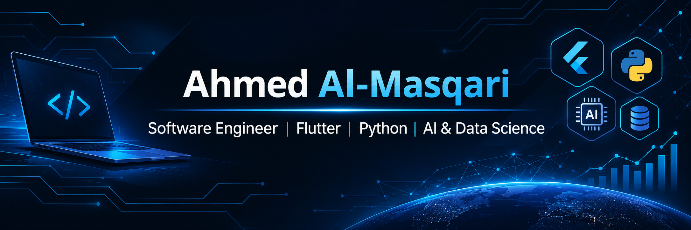

  

<h1 align="center">Ahmed Al-Masqari</h1>

<h3 align="center">
  Software Engineer | Computer Vision & Deep Learning | Flutter & Python Developer
</h3>

  Architecting reliable software systems, offline-first mobile applications, and applied AI solutions with a focus on clean architecture and engineering precision.

  
  
  

---

## 👨‍💻 About Me | نبذة عني

### 🇬🇧 English

I am a **Software Engineer** specializing in cross-platform application development, deep learning, computer vision, and data-driven systems. 

My work bridges practical software engineering and applied artificial intelligence—from designing secure, offline-first mobile and desktop systems to building multi-backbone neural networks and predictive machine learning pipelines. I prioritize clean architecture, data integrity, maintainable code, and rigorous testing.

### 🇸🇦 العربية

أنا **أحمد المصقري**، مهندس برمجيات متخصص في تطوير التطبيقات متعددة المنصات، والتعلم العميق (Deep Learning)، والرؤية الحاسوبية (Computer Vision)، والأنظمة المعتمدة على البيانات.

يجمع عملي بين الهندسة البرمجية التطبيقية والذكاء الاصطناعي؛ بدءاً من تصميم الأنظمة التجارية والمحاسبية الآمنة التي تعمل دون اتصال بالإنترنت، وصولاً إلى بناء نماذج الشبكات العصبية والتعلم الآلي التنبؤي. ألتزم بمبادئ البنية البرمجية النظيفة (Clean Architecture)، وسلامة البيانات، وجودة الكود والاختبار.

---

## 🛠️ Technical Stack

### Programming Languages

  
  
  
  

### Mobile, Desktop & Backend Development

  
  
  
  
  
  
  

### AI, Deep Learning & Data Science

  
  
  
  
  
  
  
  

### Tools & Environment

  
  
  
  
  
  

---

## 🚀 Core Competencies

- **Cross-Platform & Offline-First Systems:** Architecting resilient mobile and desktop applications with local-first storage, biometric authentication, and automated ledger reconciliation.
- **Computer Vision & Deep Learning:** Designing multi-backbone ensemble architectures, spatial attention mechanisms, and object detection pipelines for aerial and thermal imagery.
- **Predictive Analytics & Tabular ML:** End-to-end feature engineering, gradient boosting ensembles, and rigorous cross-validation for complex datasets.
- **Software Architecture & Code Auditing:** Reviewing codebases, optimizing database performance, enforcing clean code principles, and ensuring system maintainability.

---

## 💼 Selected Engineering Domains

**Computer Vision & Deep Learning**
- Thermal object detection and aerial search-and-rescue pipelines using multi-backbone ensembles and spatial attention mechanisms.
- Image classification, model evaluation, and deployment-ready deep learning workflows.

**Business, Financial & Operational Systems**
- Offline-first Point of Sale (POS), inventory management, and accounting ledger systems with strict data integrity routines.
- Shift scheduling, operational tracking, and biometric app-lock security implementations.

**Educational & Productivity Software**
- Automated examination builders, randomized question bank engines, and dynamic PDF generation.

**Data Science & Predictive Modeling**
- Agricultural yield forecasting and tabular competition benchmarks using gradient boosting ensembles and target encoding strategies.

> *Note: Several commercial and client-commissioned software repositories are kept private in accordance with non-disclosure and intellectual property agreements.*

---

## 🤝 Connect

  

---

  <i>Engineering practical solutions through clean architecture, data, and continuous innovation.</i>

